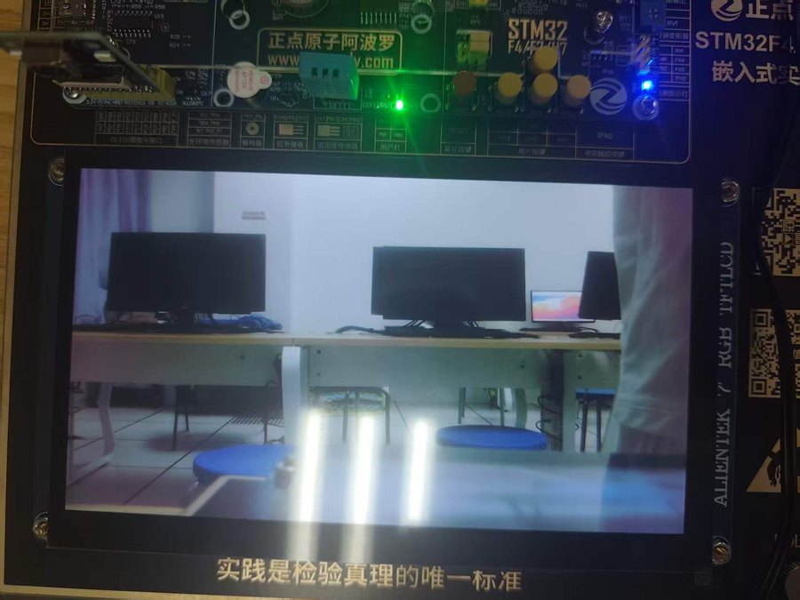
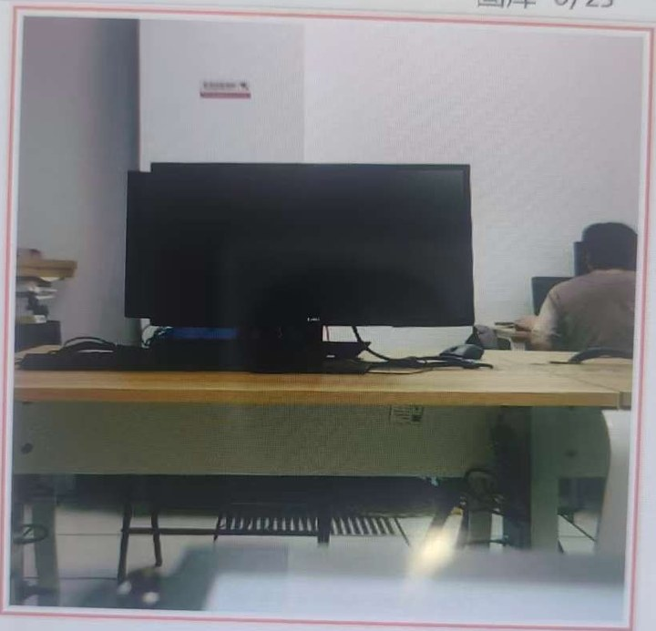
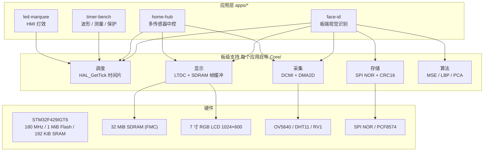

# STM32 Edge Platform

**一个跑在 STM32F429 上的裸机边缘视觉与人机交互平台。** 四个可独立编译、独立烧录的应用，共享同一套板级支持：从非阻塞 HMI 调度、定时器波形与测量，到 1024×600 RGB 大屏 UI、摄像头逐行 DMA 采集，再到完全在 MCU 上实现的人脸识别。

不依赖 RTOS，不依赖 OpenCV，不使用 SD 卡；全部算法与驱动在片内完成。

[](https://www.st.com/en/microcontrollers-microprocessors/stm32f429ig.html)
[]()
[]()
[]()
[](LICENSE)

<p align="center">
  
  
</p>
<p align="center"><sub>左：7 寸 RGB 屏上的 OV5640 实时预览（DCMI + DMA + DMA2D，无撕裂）　右：人脸识别的 480×480 取景框</sub></p>

## 亮点

| | |
|---|---|
| **4 个可独立烧录的应用** | 约 1.9 万行自研 C 代码（不含中文字库），统一的分层结构，任一应用可单独导入编译 |
| **板端人脸识别** | MSE / LBP / 颜色直方图 / PCA 四种匹配器全部手写，25 张图库，开放集判定，单次匹配 **0.3–4.2 ms** |
| **1024×600 实时预览** | DCMI 逐行 DMA + DMA2D 行搬运 + 三缓冲 VBR 换页，满屏稳定、无撕裂无滚动 |
| **定时器全覆盖** | 1 ms 基准、3 路 1 kHz PWM、PWM 输入捕获（100 Hz–10 kHz，实测误差 **0.0%**）、RCR/OPM/MOE/BKIN 硬件定量与急停 |
| **掉电保持的人脸库** | SPI NOR Flash，25 槽 × 8 KiB，magic + 版本 + 尺寸 + CRC16，坏槽跳过，Flash 缺失自动降级为内存模式 |
| **可复现** | headless 构建脚本、OpenOCD 烧录脚本、PC 端离线评估脚本（ORL 数据集复现板端分数分布） |

## 应用

| 应用 | 功能 | 关键技术 | 规模（行，不含字库） |
|------|------|----------|------|
| [`apps/led-marquee`](apps/led-marquee/) | 8 路 LED、4 种灯效、4 键切换、蜂鸣器提示 | GPIO 位映射、边沿检测消抖、PCF8574 I²C 扩展、非阻塞时间片 | 2.7k |
| [`apps/timer-bench`](apps/timer-bench/) | OLED 菜单 + 4 个定时器子应用 | TIM6 时间基准、TIM3/TIM4 多通道 PWM、PWM Input 捕获、TIM1 RCR/OPM/BKIN | 4.4k |
| [`apps/home-hub`](apps/home-hub/) | 温湿度/电压采集、中控首页、阈值预警、摄像头预览 | DHT11 单总线、ADC1、LTDC + SDRAM 帧缓冲、DCMI 逐行 DMA、DMA2D | 4.7k |
| [`apps/face-id`](apps/face-id/) | 5 人录入、4 种算法识别、开放集判定 | MSE、LBP、颜色直方图、SVD/PCA、SPI NOR 图库、DMA2D 取景框 | 6.9k |
| [`rl-env`](rl-env/) | 国产化系统上的强化学习环境 | conda 隔离、PyTorch CPU wheel、Gymnasium、Stable-Baselines3 | Python |

## 架构



分层、调度模型、内存布局与数据通路见 [docs/architecture.md](docs/architecture.md)。

## 硬件清单

| 部件 | 型号 / 规格 | 必需 | 说明 |
|------|-------------|:----:|------|
| 核心板 | 正点原子 阿波罗 V2（STM32F429IGT6） | ✓ | Cortex-M4F，180 MHz，1 MiB Flash / 192 KiB SRAM |
| 底板 | DNF429-EB 扩展底板 | ✓ | 提供 7 寸 RGB 屏接口、OV5640 座（P6）、SDRAM、NOR Flash、DHT11、电位器 |
| 显示屏 | 7 寸 RGB 并行 LCD，1024×600 | 部分 | LTDC 驱动，RGB565 |
| 摄像头 | OV5640（DVP，DCMI 接口） | 部分 | SCCB 配置，ID 应为 0x5640 |
| 传感器 | DHT11 | 部分 | 单总线，接 PB12 |
| 调试器 | CMSIS-DAP | ✓ | OpenOCD 烧录，非 ST-Link |
| 其他 | 面包板、1 kΩ 电阻 ×8、直插 LED ×8、杜邦线 | 部分 | 外接 LED 必须限流 |

引脚分配、I²C/SPI 地址与 SDRAM 地址规划见 [docs/hardware.md](docs/hardware.md)。

## 快速开始

### 1. 环境

- STM32CubeIDE 2.2.0（内置 arm-none-eabi-gcc 与 OpenOCD）
- CMSIS-DAP 调试器 + USB 线
- 可选：`git`、`bash`（用于构建与烧录脚本）

### 2. 构建

```bash
git clone https://github.com/JiangGengrui/szu-microprocessor-robotics-labs.git
cd szu-microprocessor-robotics-labs

# A. IDE 方式
#    File > Import > Existing Projects into Workspace
#    选择 apps/<app>/firmware，Build（Ctrl+B）

# B. 命令行（headless；先指向本机 CubeIDE 路径）
export CUBEIDE="/c/ST/STM32CubeIDE_2.2.0/STM32CubeIDE/stm32cubeide.exe"
./scripts/build.sh timer-bench
```

产物：`apps/<app>/firmware/Debug/<project>.elf`（四个工程分别为 `exp1`~`exp4`）。

### 3. 烧录

```bash
./scripts/flash.sh timer-bench
# 等价于：
# openocd -f apps/timer-bench/firmware/dap.cfg \
#   -c "program apps/timer-bench/firmware/Debug/exp2.elf verify reset exit"
```

### 4. 运行

各应用的按键约定与验收现象见对应 README。通用自检：上电后 LED 全亮 500 ms 再全灭 —— 这是四个应用共用的接线检查。

## 仓库结构

```
.
├── apps/
│   ├── led-marquee/          # GPIO / 按键 / I²C 蜂鸣器
│   │   └── firmware/         #   CubeIDE 工程（Core + Drivers + .ioc + .ld + dap.cfg）
│   ├── timer-bench/          # 定时器：PWM、捕获、高级定时器保护
│   │   ├── firmware/
│   │   └── tools/            #   中文字库生成
│   ├── home-hub/             # 传感器 + RGB LCD + 摄像头
│   │   ├── firmware/
│   │   └── tools/
│   └── face-id/              # 板端人脸识别
│       ├── firmware/
│       └── tools/            #   PC 端离线评估（ORL）
├── rl-env/                   # 银河麒麟 + PyTorch 强化学习环境
├── docs/
│   ├── architecture.md       # 分层、调度模型、内存与数据通路
│   ├── hardware.md           # BOM、引脚、地址规划
│   ├── build-and-flash.md    # 工具链、构建、烧录、排障
│   └── images/
└── scripts/
    ├── build.sh              # headless 构建
    └── flash.sh              # OpenOCD 烧录
```

## 设计要点

1. **单线程 + 时间片，不引入 RTOS。** 周期任务全部由 `HAL_GetTick()` 差值驱动，主循环从不阻塞；按键扫描周期本身就是消抖窗口，长按只在"松开→按下"边沿触发一次。
2. **先算参数，再看现象。** 定时器 PSC/ARR、LTDC 像素时钟、DMA 传输计数、SDRAM 地址划分都先按公式算出再写配置，异常时回读寄存器确认，而不是试参数。
3. **能交给硬件的绝不留给软件。** 固定 N 个脉冲用 RCR + 单脉冲模式而非中断停表；故障急停用 BKIN 清零 MOE；图像行搬运用 DMA2D 而非 CPU `memcpy`；显示换页用 LTDC VBR，避开撕裂。
4. **先离线验证，再上板。** 开发期用 mock HAL 在 PC 上编译灯效与按键的真实源码做断言（18/18 通过）；人脸识别的分数分布用 ORL 数据集在 PC 端复现同一链路，用来定阈值、分析可分性。
5. **资源按预算分配，不按习惯分配。** 192 KiB 片内 SRAM 放不下任何一帧 RGB 画面，因此帧缓冲、算法工作区全部落在 SDRAM 的固定地址段；模型、图库、栈的大小都在 `face_cfg.h` 一处集中定义。

## 实测数据

| 指标 | 结果 | 出处 |
|------|------|------|
| 频率/占空比测量误差 | 100 Hz/25%、1 kHz/50%、10 kHz/75% 三组均为 **0.0%** | timer-bench |
| 固定次数脉冲 | N = 1 / 3 / 5 / 9 次，实测次数与设定一致 | timer-bench |
| ADC 电压表斜率 | 实测 0.808 mV/LSB vs 理论 0.806 mV/LSB，偏差 **0.25%** | home-hub |
| 摄像头预览 | 1024×600 RGB565，满屏稳定，无撕裂/滚动；切页 20 次后数据仍刷新 | home-hub |
| 人脸识别（20 次测试） | MSE 通过率 80%／误通过 0%；LBP 80%／0%；颜色直方图 70%／0%；PCA 80%／**30%** | face-id |
| 单次匹配耗时 | MSE 2.2 ms、LBP 4.2 ms、颜色直方图 0.3 ms、PCA 1.1 ms | face-id |
| 图库持久化 | 25/25 槽断电重启后完整加载，CRC 失败 0 槽 | face-id |

## 已知限制

- `home-hub` 与 `face-id` 依赖底板上的 SDRAM、7 寸屏与 OV5640；仅用核心板无法运行。
- 人脸识别采用固定取景框对齐，**不是自动人脸检测**；5 人 × 5 张的样本量下，开放集识别已进入两类错误此消彼长的区间（见 [apps/face-id](apps/face-id/)）。
- `face-id` 工程没有 `.ioc`，外设配置固化在 `stm32f4xx_hal_msp.c` 与各模块初始化中，改引脚需直接改代码。
- `rl-env` 的 Isaac Lab 扩展在 glibc 2.31 的麒麟 V10 SP1 上无法安装（依赖 manylinux_2_35 轮子）。

## 路线图

- [ ] 把四个应用的公共驱动抽成 `bsp/` 公共库，消除重复
- [ ] 为 `face-id` 增加轻量人脸检测，替代固定取景框
- [ ] 定时器测量加入多次平均，压低下限量化误差
- [ ] 引入 CI：用 arm-none-eabi 在 GitHub Actions 上做编译冒烟测试

## 许可

代码与文档以 [MIT](LICENSE) 发布。`apps/*/firmware/Drivers` 为 STMicroelectronics 的 HAL/CMSIS 文件，按 BSD-3-Clause 分发，未作修改。OV5640 初始化表参考了正点原子公开例程。
