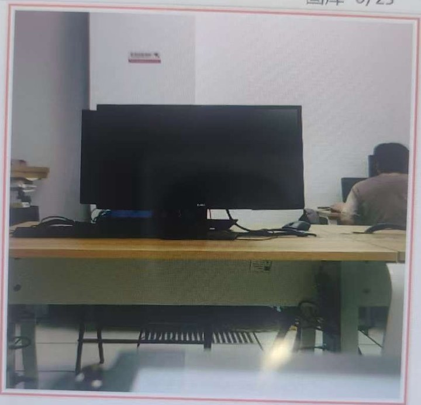

# face-id

完全跑在 STM32F429 上的人脸录入与识别系统：固定取景框拍照建库，写入板载 SPI NOR Flash；识别时同一张查询图分别送入 **MSE 模板匹配、LBP、颜色直方图、SVD/PCA 特征脸** 四个匹配器，各自给出身份、分数与通过/不通过。

不依赖 OpenCV、不使用 SD 卡、不需要 PC 参与推理。四种算法全部以 C 手写，共用同一张 48×48 灰度输入。

<p align="center"></p>

## 流水线

```
OV5640 ──DCMI+DMA 逐行──> DMA2D 只写取景框(480×480)
                                │
                     拍照：框内取图 → 10×10 块平均 → 48×48 → 灰度 2304 B
                                │
     ┌───────────────┬──────────┴─────────┬──────────────────┐
   MSE 2304 维    LBP 4×4×59=944     COL 3×16=48         PCA k=12
     └───────────────┴──────────┬─────────┴──────────────────┘
                     独立阈值 + 开放集判定 → LCD / 红绿 LED
```

## 硬件

| 功能 | 接口 | 引脚 |
|------|------|------|
| 摄像头 | DCMI + DMA2_Stream1 | D0~D7：PC6~PC9、PC11、PD3、PB8、PB9 |
| SCCB | 软件 IIC | PB4=SCL / PB3=SDA（4.7 kΩ 上拉） |
| LCD | LTDC Layer1 | 1024×600，帧缓冲 0xC0000000 |
| NOR Flash | SPI5 | PB2=SCK / PB14=MISO / PB15=MOSI / PB12=CS |
| LED | PB0 绿 / PB1 红 | 通过绿、拒绝红 |

## 关键设计

**单图层 + 写入范围隔离。** 曾尝试 LTDC 双图层（Layer1 画 UI、Layer2 叠视频），上板整屏无显示，最终改为单图层：UI 与视频都画在 `0xC0000000` 的同一块帧缓冲里，靠**摄像头只写 480×480 取景框区域**保证互不重叠。这比双图层更稳，也省一层显存。

**四路匹配器的资源账**（N=25 张）：

| 算法 | 特征维度 | 单次匹配 | 距离 | 图库占用 |
|------|----------|----------|------|----------|
| MSE | 2304（原始灰度） | 25×2304 乘加 | 均方误差 | 57.6 KiB |
| LBP | 944（4×4×59） | 2304×8 比较 + 25×944 项 | 卡方 | 46.1 KiB |
| 颜色直方图 | 48（3×16） | 2304 量化 + 25×48 项 | 卡方 | 2.4 KiB |
| PCA | 12 主成分 | 12×2304 乘加 + 25×12 距离 | 欧氏 | 模型 108 KiB（SDRAM） |

**PCA 的小样本做法**：样本 25 个远小于像素维数 2304，直接分解协方差矩阵既慢又没必要。改为对 25×25 的 Gram 矩阵 `AᵀA` 求特征向量，再用 `A·V` 构造特征脸；主成分数 `k` 同时受 `N-1` 与特征值截断限制，本实现取 12。

**阈值标定与开放集判定**：用验证图分别为四种算法定阈值——两类分数分离时，若 `min/max < 3` 取算术中点，否则取几何平均（距离是误差量，按倍数变化）；两类重叠时不存在安全阈值，改在标定集上扫描到等错误率点。**测试集只使用一次，不参与调参。**

**图库格式**：25 槽 × 8 KiB（16 B 记录头 + 4608 B RGB565 原图），写在 NOR Flash 独立扇区，带 magic、版本、尺寸、CRC16。上电逐槽校验，坏槽跳过；读不到器件 ID 时自动降级为"仅内存"并在状态栏明示。

## 构建与运行

```bash
./scripts/build.sh face-id
./scripts/flash.sh face-id
```

| 按键 | 作用 |
|------|------|
| K0 | 拍照 / 触发识别 |
| K1 | 切换录入、识别、标定、回放模式 |
| K2 | 换人 / 换算法 |
| WK 长按 | 清空图库 |

本工程**没有 `.ioc`**：外设配置固化在 `Core/Src/stm32f4xx_hal_msp.c` 与各模块初始化函数中，改引脚需直接改代码。

## 实测

| 算法 | 正确通过率 | 误拒率 | 未录入者误通过率 | 单次耗时 |
|------|-----------|--------|------------------|----------|
| MSE | 80%（8/10） | 20% | 0%（0/10） | 2.2 ms |
| LBP | 80%（8/10） | 20% | 0%（0/10） | 4.2 ms |
| 颜色直方图 | 70%（7/10） | 30% | 0%（0/10） | 0.3 ms |
| PCA | 80%（8/10） | 20% | **30%（3/10）** | 1.1 ms |

图库：5 人 × 5 张全部录满，断电重启后加载 25/25，CRC 失败 0 槽。

耗时为"取照完成到给出判定"的匹配段，由 `arm-none-eabi-gcc -O2` 反汇编统计内层指令数 × 迭代次数折算（1 CPI，`vdiv`/`vsqrt` 计 14 周期，180 MHz），是下界，未计 SDRAM 等待。

## 离线评估（PC）

板上图库在 NOR Flash 里、PC 读不出来，因此用公开 ORL/AT&T 人脸库（40 人 × 10 张，92×112 灰度）复现**与板端逐行一致**的链路：铺满 480×480 取景框 → RGB565 10×10 块平均 → 48×48 → 灰度 → 四种距离。这样得到与板上同量纲的分数，但不受摄像头曝光漂移影响，用于分析算法本身的判别力与定阈值。

```bash
cd tools
# 将 ORL 数据集解压为 tools/orl/s1/1.pgm ... s40/10.pgm
python offline_repro.py     # 打印标定集/测试集结果并重写 result.json
```

依赖 `numpy`、`Pillow`。ORL 数据集因版权未随仓库分发；目录结构不同时改脚本第 40 行的 `ORL` 常量即可。

## 经验与已知问题

- **MSE 的分数主要反映曝光一致性，而不是长相相似度。** 由 `D = (Δm)² + Var(e)` 可知，仅整体亮度差 5 灰阶就能把分数抬高数倍。板上出现"本人 2185、外人 745"的倒挂，本质是自动曝光漂移吃掉了本来只有 2% 的分离余量——问题不在阈值，而在特征。
- **人脸占框比例决定还剩多少五官信息**：框内脸宽 288 px（占 60%）时缩略图约 29 px；只占 30% 时仅 14 px，LBP 的 16 个 12×12 分区里大部分统计的是背景。
- **采集一致性比换算法更有效**：距离、光照、姿态的方差若已接近阈值余量，换算法只改变量纲，不改善可分性。
- **指针单位错误很难查**：地址宏 `0xC0000000 + 48*1024 + 272` 强转 `uint16_t*` 后指向第 24712 个像素（即 (136,24)），因为 RGB565 每像素两字节、漏了 `*2`。表现为首次进工作页 UI 缺角、取图偏移，而第二次进页面又"正常"（走整页重画）。凡是强转成指针的地址宏，必须写清单位是字节还是像素。
- **只在第一次出现的异常，优先查只执行一次的初始化代码。**
- 5 人 × 5 张的样本量下，开放集识别已进入两类错误此消彼长的区间：继续微调阈值不会带来实质改善，能压的只有采集一致性与样本数。
