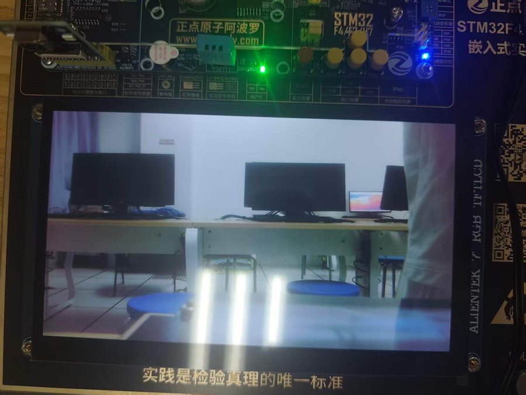
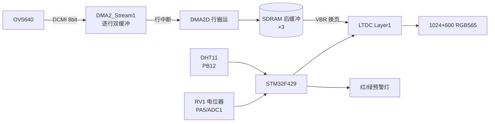

# home-hub

把温湿度、模拟电压、RGB 大屏与摄像头集成到一个多页面终端：DHT11 采温湿度、板载电位器经 ADC 做电子电压表、7 寸 RGB LCD 显示中控首页、OV5640 提供实时预览页，并按三路阈值做双色 LED 预警。

这个应用的主线不是界面，而是 **SDRAM 帧缓冲规划、DMA 拆分与显示同步**。

<p align="center"></p>

## 功能

- 中控首页：项目标题、温度、湿度、电压（原始 ADC + 两位小数电压）、各模块状态；
- 电子电压表：ADC1_IN5 采样 + 8 次平均；
- 阈值预警：温度 / 湿度 / 电压三路上限，正常、越限、故障三态输出；
- 摄像头页：OV5640 实时预览，按键与首页互切，预警在两页均生效。

## 硬件

| 功能 | 接口 | 引脚 | 说明 |
|------|------|------|------|
| DHT11 | 单总线 | PB12 | 开漏 + 上拉，采样间隔 ≥1 s |
| 电压表 | ADC1_IN5 | PA5 | RV1 经杜邦线接入，0~3.3 V，12 位 |
| RGB LCD | LTDC 20 线 | 见板级引脚表 | 1024×600，RGB565，AF14 |
| 摄像头 D0~D7 | DCMI | PC6~PC9、PC11、PD3、PB8、PB9 | AF13 |
| 摄像头 SCCB | 软件 IIC | PB4=SCL / PB3=SDA | 读 ID 应为 0x5640 |
| 预警 LED | PB0 绿 / PB1 红 | — | 正常绿常亮；越限红 2 Hz；故障红常亮 |

## 数据通路



## 实现要点

**显示：三缓冲 + 局部刷新。** 单帧 1024×600×2 B = 1.17 MiB，远超 192 KiB 片内 SRAM，必须放外部 SDRAM：主帧缓冲 `0xC0000000`，三块后缓冲 `0xC0300000 / 0xC0440000 / 0xC0580000`（间隔 1.25 MiB）。像素时钟由 PLLSAI 产生（PLLSAIN=360、R=2、D=4 → 45 MHz）。首页更新只重绘数值区背景再写字符，不清整屏。

**采集：逐行 DMA + VBR 换页。** 整帧 1.2 MB 超过 F4 DMA 的 16 位传输计数上限（65535），因此：

1. DMA 每次搬一整行（1024 px = 512 个 32 位字），双行缓冲轮转；
2. 行传输完成中断里用 **DMA2D** 写进后缓冲（约 36 μs/行，CPU `memcpy` 来不及）；
3. 帧结束后在 DCMI 帧中断请求 LTDC 垂直消隐换页（VBR），换页只发生在两帧之间，因此无撕裂。

**预警：三态 + 回差。**

| 状态 | 绿 LED1 | 红 LED0 | 屏幕 |
|------|---------|---------|------|
| 正常 | 常亮 | 熄灭 | NORMAL |
| 任一越限 | 熄灭 | 2 Hz 闪烁 | 标出越限项 |
| 数据无效 / 传感器失联 | 熄灭 | 常亮 | 故障提示 |

默认阈值 30.0 ℃ / 70.0% / 3000 mV，集中在一个配置常量里。恢复条件为"低于上限 − 回差"，避免临界点红绿反复抖动。预警逻辑与页面无关，切到摄像头页仍在运行。

## 构建与运行

```bash
./scripts/build.sh home-hub
./scripts/flash.sh home-hub
```

上电后进入中控首页；KEY0 / KEY1 切换首页与预览页。旋转 RV1 或对 DHT11 哈气即可触发预警。

界面汉字由 `tools/gen_chinesefont.py` 生成（C51 逐列取模，24×24 与 32×32），改文案后重跑脚本替换 `Core/Inc/chinesefont.h`。

## 实测

| 项目 | 结果 |
|------|------|
| 温湿度 | 26.0 ℃、63.0~64.0% RH，校验和持续通过 |
| ADC 线性度 | 219 → 0.17 V，2100 → 1.69 V；实测斜率 0.808 mV/LSB vs 理论 0.806，偏差 **0.25%** |
| 预警 | 单项/多项越限、传感器拔出、恢复，五种情形均符合上表；回差后无抖动 |
| 摄像头 | ID 0x5640，1024×600 满屏稳定，无撕裂无滚动，动作残影同步 |
| 集成 | 切页 20 次后首页仍刷新；预览期间预警有效；DHT11 拔出后显示故障而非旧值 |

## 已知问题

- **LTDC 引脚映射**：CubeMX 自动分配的引脚可能与板上走线不一致（颜色分量被分到未接屏的引脚），表现为背光亮但黑屏。按"引脚 → 速度 → 时序 → 极性 → 层参数"顺序排查，逐根核对 20 根信号线。
- **画面滚动 + 撕裂**：帧中断被 HAL 处理完后自动关闭，行号不再按 VSYNC 归零；同时逐行直写正在扫描的帧缓冲。解决是帧回调重新使能中断 + 三缓冲 + VBR。
- 摄像头与 LCD 的帧缓冲必须分开规划，否则会出现"画面正常但 UI 花屏"。
- 外设初始化失败时不要只重试：地址、引脚、调试器占用都可能表现成"设备无响应"，应按数据通路逐段定位。
