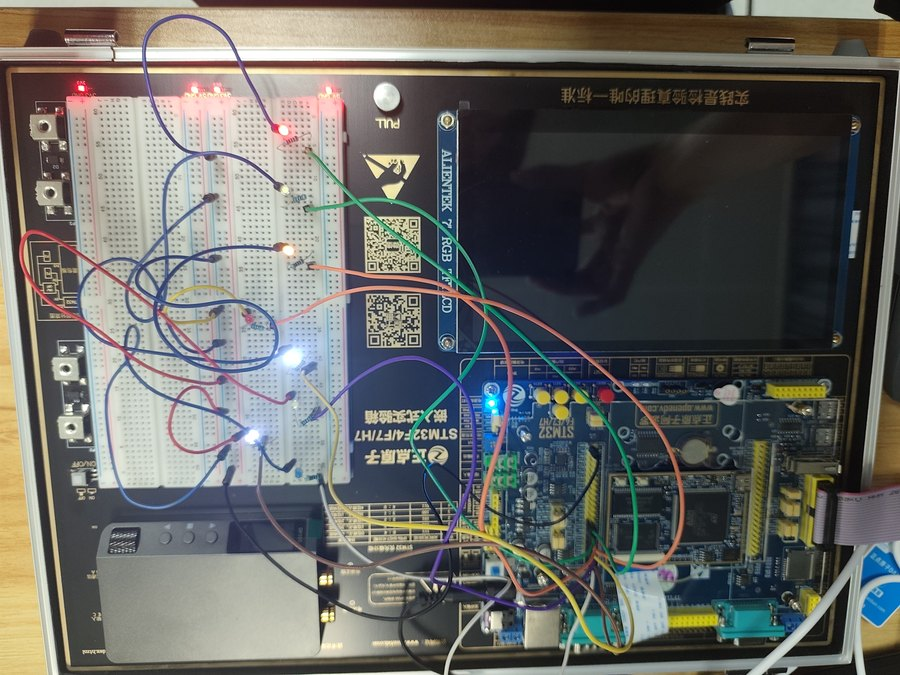

# led-marquee

8 路 LED、4 种灯效、4 个按键、1 个蜂鸣器构成的 HMI 最小系统。它是整个平台的基础模板：**单线程 + 时间片 + 边缘检测**，后续三个应用都沿用了这套调度结构。

<p align="center"></p>

## 功能

- 8 个 LED 实现 4 种差异明显的灯效，150 ms/步；
- KEY0 / KEY1 / KEY2 / WK_UP 分别切换到特效 1/2/3/4；
- 每次有效按键蜂鸣一声（80 ms），**长按只响一次**；
- 上电自检：8 灯全亮 500 ms → 全灭 → 蜂鸣 → 进入默认特效；
- 板载 LED0 每 500 ms 心跳翻转；LED1 用于指示 I²C 扩展芯片异常。

## 硬件

| 项目 | 连接 | 有效电平 |
|------|------|----------|
| LED0 ~ LED7 | PG14 / PA1 / PC4 / PH13 / PH15 / PI1 / PG11 / PI5 | 低电平点亮 |
| KEY0 / KEY1 / KEY2 | PH3 / PH2 / PC13 | 低有效，内部上拉 |
| WK_UP | PA0 | 高有效，内部下拉 |
| 蜂鸣器 | PCF8574 P0，I²C2（PH4=SCL / PH5=SDA） | 写 `0xFE` 响，`0xFF` 停 |

接线：`3.3 V → 1 kΩ → LED 正极 → 负极 → GPIO`。

## 结构

| 文件 | 职责 |
|------|------|
| `Core/Src/main.c` | 上电自检、180 MHz 时钟、主循环调度 |
| `Core/Src/led.c` | `LED_Write(pattern)`：bit i → 第 i 个 LED |
| `Core/Src/key.c` | `KEY_Scan()`：周期采样 + 边沿检测 |
| `Core/Src/beep.c` | `BEEP_Init/Beep/Task`：扩展芯片探测与非阻塞鸣叫 |
| `Core/Src/effects.c` | `EFFECT_Set/Step`：4 种灯效序列 |

## 实现

**调度**（全部基于 `HAL_GetTick()`，主循环不出现 `HAL_Delay`）：

| 周期 | 动作 |
|------|------|
| 10 ms | 扫描按键；有事件则鸣叫 80 ms 并切换特效 |
| 150 ms | 推进一格灯效 |
| 每次循环 | 检查蜂鸣器是否到期并关闭 |
| 500 ms | 心跳灯翻转 |

**消抖与单次触发**：不额外加延时，10 ms 采样周期本身就是消抖窗口；只上报"上次松开、本次按下"的边沿，因此长按天然只触发一次。

| # | 灯效 | 序列 | 步数 |
|---|------|------|:----:|
| 1 | 单灯单向流水 | `1 << step` | 8 |
| 2 | 乒乓往返 | `{0,1,2,3,4,5,6,7,6,5,4,3,2,1}` | 14 |
| 3 | 双灯对称开合 | `{0x81, 0x42, 0x24, 0x18}` | 4 |
| 4 | 奇偶交替 | `0x55 ↔ 0xAA` | 2 |

**蜂鸣器**：`BEEP_Beep(ms)` 写 `0xFE` 并记录到期时刻，`BEEP_Task()` 到时写 `0xFF` 关闭。PCF8574 的 P1~P7 接着网络复位等外设，**写入时其余位必须保持 1**，否则会误动其他外设。

## 构建与运行

```bash
./scripts/build.sh led-marquee
./scripts/flash.sh led-marquee
```

上电后应看到：8 灯全亮 500 ms → 全灭 → 蜂鸣一声 → 特效 1 开始流动。依次按四个键切换特效，长按任一键只响一声。

**"全亮 500 ms"是接线自检**：若有灯不亮，先查该路杜邦线与电阻，不要先怀疑代码。

## 实测

- 开发期间用 mock HAL + gcc 在 PC 上编译工程真实源码，18 项断言全部通过（四特效序列、按键事件、长按单次、PCF8574 字节安全、非阻塞调度）；该测试脚手架未随仓库分发，仓库内可复现的是编译与上板行为；
- 上板：自检、四键切换、长按单次、心跳灯均符合预期。

## 已知问题

- 蜂鸣器经 I²C 扩展芯片控制，与直接用 GPIO 驱动的板型（如 F103 精英板）代码不兼容，移植时需替换 `beep.c`。
- 灯效节拍由主循环计时，长时间运行会随主循环负载产生毫秒级抖动；需要严格等间隔时应改为定时器中断驱动。
