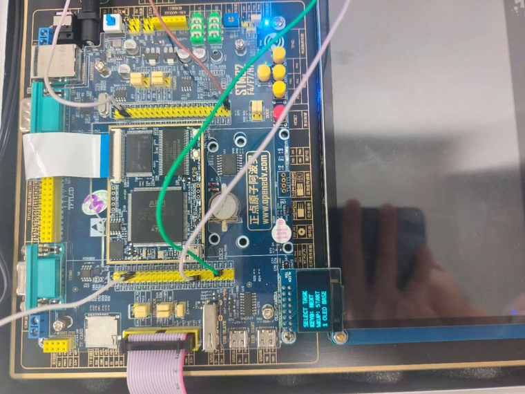
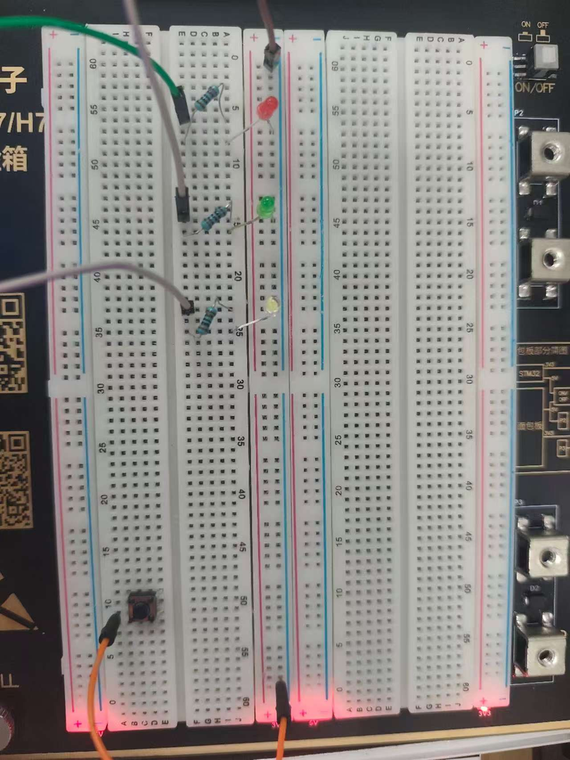

# timer-bench

一个把 STM32 三类定时器用到位的工具箱：**五组子应用编入同一份固件**，上电进菜单选择，不需要改宏、重编译、重烧录就能现场切换。

<p align="center">　</p>

## 子应用

| # | 子应用 | 定时器 | 通道 / 引脚 | 关键参数 |
|---|--------|--------|-------------|----------|
| 1 | OLED 基础显示 | — | 8080 并口 | 4 行文本，16×16 汉字 + 8×16 ASCII |
| 2 | 随机反应速度测试 | TIM6（基本） | 内部计数 | PSC=89，ARR=999 → 1 ms @90 MHz |
| 3 | 三色流水呼吸灯 | TIM3 + TIM4 | PA6 / PA7 / PB6 | 三路 1 kHz PWM，1000 级 |
| 4 | 频率与占空比自测 | TIM3 输出 + TIM4 捕获 | PA6 → PB6 | PSC=89，ARR=9999 / 999 / 99 |
| 5 | N 次闪光与硬件急停 | TIM1（高级） | PA8；BKIN=PA6 | PSC=17999，ARR=4999 → 2 Hz |

**菜单操作**：KEY0 在 1~5 号之间循环，WK_UP 启动，任务中按 KEY1 退出并释放本任务占用的外设。

## 实现要点

### 时钟树先算清楚

HSE 25 MHz → PLLM=25 / PLLN=360 / PLLP=2 → SYSCLK 180 MHz；AHB ÷1，APB1 ÷4 = 45 MHz，APB2 ÷2 = 90 MHz。APB 预分频 ≠ 1 时定时器时钟为 2×PCLK，因此：

```
TIM3 / TIM4 / TIM6 = 90 MHz      TIM1 = 180 MHz
f_update = f_TIM / ((PSC+1)(ARR+1))
D        = CCR / (ARR+1)
```

把 180 MHz 当作所有定时器的输入，是这类工程最常见的错误来源。

### 子应用 2 · 反应速度

TIM6 每 1 ms 进中断，中断里只置标志；主循环用状态机处理"随机等待 2~5 s → 亮灯计时 → 按键停表 → 显示成绩"，并识别提前按键的抢跑。10 轮实测 169~450 ms。

### 子应用 3 · 三色呼吸

红/绿共用 TIM3 的 CH1/CH2（同一 PSC/ARR，各自 CCR），蓝用 TIM4_CH1。三路相位不同，周期性改写 CCR 即得同步呼吸、三色流水、警灯闪烁三种模式。

### 子应用 4 · 自测仪

TIM3 输出已知频率/占空比的 PWM，杜邦线接到 TIM4_CH1 的 PWM Input 模式（一路捕获周期、一路捕获高电平），再由 `f = f_capture/(CCR1+1)`、`D = CCR2/CCR1` 反算。断开跳线后约 1 s 内显示"无信号"，不保留旧值。

### 子应用 5 · 定量与保护

固定 N 个脉冲**不用"更新中断里停表"**——实测会出现"上电不输出"与"停不下来"交替的现象，原因是中断停表受影子寄存器装载时序影响。改用 **RCR + OPM**，由硬件在最后一个更新事件清 CEN：

- 边沿对齐模式下 `RCR = N-1`（RCR 计的是重复次数，一个 PWM 周期对应一次重复）；
- 停表只清 CEN，不动 MOE，因此输出锁存在有效电平、LED 保持常亮 —— 这是 OPM 的固有行为，不是缺陷；
- BKIN 相反：硬件清零 MOE，输出立即回到安全低电平，释放后不自动恢复，必须人工确认重新使能。

两者对比就是"故障安全 + 人工确认"的落地方式。

## 构建与运行

```bash
./scripts/build.sh timer-bench
./scripts/flash.sh timer-bench
```

子应用 4 需要一根杜邦线把 PA6 跳到 PB6（确认 PB6 已配为复用输入，**不可两个推挽输出直连**）；子应用 5 的 BKIN 也接 PA6，仅做 3.3 V 逻辑演示。

## 实测

| 子应用 | 目标 | 结果 |
|--------|------|------|
| 1 | 显示名称并递增计数 | 无缺字，计数每 0.5 s +1 |
| 2 | 2~5 s 随机等待 + 抢跑识别 | 10 轮 169~450 ms，最好 169 ms，抢跑判定正确 |
| 3 | 三路 1 kHz PWM，三模式 | 三路均约 1 kHz，切换与过渡正常 |
| 4 | 100 Hz/25%、1 kHz/50%、10 kHz/75% | 三组误差 **0.0%** |
| 5 | N=1/3/5/9 次闪光 + 急停 | 次数全部准确；急停立即熄灭且不自动恢复 |

子应用 4 能做到 0.0%，是因为输出端与捕获端共用同一条时钟树，分频是确定的整数比。用于测**外部**信号时，主要误差是 ±1 计数的量化误差（10 kHz 时整周期仅 100 个计数，约 1%）、晶振偏差与输入边沿质量。

## 辅助脚本

屏幕文案改动后，用 `tools/gen_chinesefont.py`（24×24 / 32×32）与 `tools/gen_chinesefont16.py`（16×16）重新生成 `chinesefont.h`：C51 逐列取模、高位在前，与工程内 ASCII 字库一致。

## 已知问题

- 高级定时器第一次跑不出波形时，先确认 **MOE 已使能**（寄存器方式配置必须在启动前显式置位）。
- OPM 停表后若希望 LED 熄灭，需在停表后清 MOE，或启动前把 CCR 置 0。
- 五个子应用复用 PA6/PB6，切换任务时必须先反初始化上一个任务占用的外设。
- 重新生成代码可能把应用占用的引脚分配给其他外设，`.ioc` 中已移除无关外设来规避。
