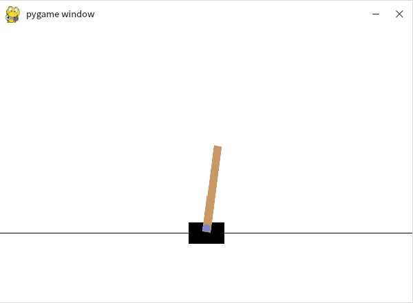

# rl-env

在**银河麒麟桌面操作系统 V10 SP1**（国产化 x86_64 环境）上从零搭一套可复现的强化学习运行环境：独立 Python 3.10 + PyTorch + Gymnasium + Stable-Baselines3，并用 CartPole 图形演示验证整条链路。

这个子项目解决的不是"装包"，而是几件具体的现实问题：系统 Python 只有 3.8 且不可替换、PyTorch CPU wheel 不在常规 PyPI 镜像里、SB3 对 torch 有版本下限、Isaac Lab 对 glibc 有硬性要求。

<p align="center"></p>

## 环境

| 项目 | 配置 |
|------|------|
| 宿主机 | Windows 11 + VMware Workstation 17 |
| 客户机 | 银河麒麟桌面操作系统 V10 SP1（HWE，x86_64） |
| 资源 | 4 核 / 8 GB / 60 GB 动态磁盘，NAT 网络，3D 加速 2 GB 显存 |
| Python | 3.10.22（Miniconda 环境 `rl-course`） |
| 核心包 | torch 2.9.0+cpu、torchvision 0.24.0+cpu、gymnasium[classic-control]、stable-baselines3[extra]、numpy、scipy、matplotlib、tqdm |

## 为什么必须建独立环境

麒麟 V10 SP1 自带 `python3` 为 **3.8.10**（裸 `python` 甚至指向 2.7.18），而 PyTorch、Gymnasium 要求 Python ≥ 3.10；同时系统 Python 被 `apt` 等组件硬编码依赖，直接升级会破坏包管理器。因此不动系统解释器，用 conda 提供隔离环境。

隔离性用三条命令确认，路径必须一致：

```bash
which python && python -V && python -m pip -V
# 期望均指向 ~/miniconda3/envs/rl-course/bin/python，版本 3.10.x
```

## 安装

```bash
# 1. 独立环境
conda create -n rl-course python=3.10 -y
conda activate rl-course

# 2. 镜像（外网受限时必需）
python -m pip config set global.index-url https://pypi.tuna.tsinghua.edu.cn/simple

# 3. PyTorch：虚拟机无 GPU，装 CPU 版；CPU wheel 不在普通 PyPI 镜像里
python -m pip install torch==2.9.0+cpu torchvision==0.24.0+cpu \
  --find-links https://mirrors.aliyun.com/pytorch-wheels/cpu/

# 4. 强化学习与科学计算依赖（顺序：先 torch 后 SB3）
python -m pip install 'gymnasium[classic-control]' 'stable-baselines3[extra]' \
  numpy scipy matplotlib tqdm

# 5. 校验并固化
python -m pip check
python -m pip freeze > requirements-lock.txt
conda env export > environment.yml
```

## 验证

```bash
python verify_env.py
```

脚本依次打印各包版本、CUDA 可用状态、张量运算结果，再用随机动作运行 `CartPole-v1` 200 步（含窗口渲染），最后输出"最小环境验证通过！"。

实测：

| 项目 | 结果 |
|------|------|
| PyTorch | 2.9.0+cpu，`torch.cuda.is_available()` = False（CPU 版预期） |
| 张量运算 | `[1,2] * 2 → [2.0, 4.0]` |
| 依赖一致性 | `pip check` → No broken requirements found |
| CartPole | 窗口正常弹出、可交互、正常退出 |

> 随机动作演示只验证环境接口与渲染，**不代表模型已训练**。真正的训练要用 SB3 的 `PPO(...).learn()`，且需 GPU 才有实用速度。

## 扩展组件的实测结论

| 组件 | 结果 |
|------|------|
| Atari（ALE） | 安装 `gymnasium[atari]` 成功，`ALE/Breakout-v5` 空间正常，Breakout 窗口可运行 |
| Isaac Lab 3.0 | **安装失败**：依赖 `omniverseclient==2.74.0` 仅提供 manylinux_2_35 轮子，本机 glibc 2.31，无适配 wheel |

Isaac Lab 的失败是系统级硬约束，不是操作问题：官方要求 Ubuntu 22.04+（glibc ≥ 2.35）与特定 NVIDIA 驱动，麒麟 V10 SP1 无法满足。

## 注意事项

- **别动系统 Python**：升级 3.8 会连带破坏 `apt`。
- **conda 服务条款**：创建环境报 `CondaToSNonInteractiveError` 时，是未接受 Anaconda 官方仓库条款，换国内镜像源即可绕过。
- **CPU wheel 的写法**：必须 `--find-links` 指向 pytorch-wheels 镜像并带 `+cpu` 后缀；误装 CUDA 版会多下约 2 GB 且完全用不上。
- **版本下限要逐项核对**：SB3 要求 `torch >= 2.8`（调整安装顺序即可满足），Isaac Sim 要求 `glibc >= 2.35`（无法绕过）。多数"装不上"在核对要求后就能预判。
